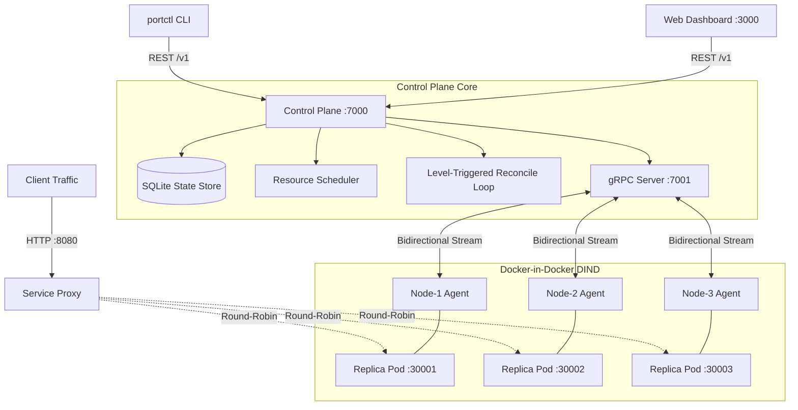

# ⚓ Portside

> **A Kubernetes-inspired distributed container orchestrator built in TypeScript.**  
> Features a level-triggered control plane, bidirectional gRPC agent streams, resource-aware scheduler, zero-downtime rolling updates, and self-healing SQLite-backed reconciliation.

[](https://github.com/Dhanvin1520/Portside/actions/workflows/ci.yml)

---

## 📐 Architecture



---

## 📂 Repository Structure

```
├── agent/            # Node agent managing local Docker containers via Dockerode
├── cli/              # portctl CLI tool (apply, get, scale, rollout, drain, uncordon)
├── control-plane/    # Central orchestrator: scheduler, reconciler, REST API, SQLite
├── dashboard/        # Web UI for real-time cluster visualization
├── examples/         # Sample multi-replica application deployment YAMLs
├── proto/            # gRPC protocol buffer definitions (agent.proto)
├── proxy/            # Health-aware reverse proxy & round-robin load balancer
├── shared/           # Shared types, logging utilities, and declarative YAML parser
└── tests/            # Unit + regression tests, fast-check properties, simulated cluster, chaos harness
```

---

## 📊 Resilience Testing & Benchmarks

Portside is verified at two levels.

**1. Simulated cluster test** (`npm run test:integration`, runs in CI on every push). It runs the real control plane (SQLite, scheduler, reconcile loop, gRPC, REST) and three real agents (registration, heartbeat stream, reconnect loop) in one process. Only Docker is replaced by an in-memory runtime, so containers start instantly. Measured on a laptop:

| Scenario | Measured | Asserted |
| :--- | :--- | :--- |
| Crashed container back to ready | ~4.0 s | < 5 s, counted as exactly 1 restart |
| Node failure: replicas rescheduled | ~4.0 s | < 5 s |
| Node failure: all replicas ready again | ~5.0 s | reported |
| Rolling update, 6 replicas | ~12.5 s | maxSurge / maxUnavailable never violated (sampled every 25 ms) |
| Node rejoins after failure: stale copies stopped | ~0.1-0.2 s | 0 duplicate containers |
| Control plane restart: agents reconnected | ~1.0-1.5 s | 0 containers restarted, 0 nodes marked NotReady |

These timings measure the orchestration logic only. Real container start-up and image pulls come on top.

**2. Live chaos harness** (`npm run chaos`, `tests/chaos/chaos.ts`) against the real 3-node docker-compose cluster. It kills app containers, hard-stops worker nodes, partitions a node off the network, SIGKILLs the control plane, and runs rollouts, a rollback and a re-apply under steady HTTP load through the proxy. Every number is measured: there are no fallback values, a missed target is reported as FAIL with a non-zero exit code, and results are written to `tests/chaos/results/latest.{json,md}`.

Run it locally after `docker compose up -d --build`, or start the **Portside Chaos (live cluster)** workflow from the GitHub Actions tab, which boots the cluster on a runner and uploads the results.

---

## 🚀 Quick Start

### 1. Prerequisites
- Docker & Docker Compose
- Node.js `>= 22.5.0` (the control plane uses the built-in `node:sqlite`)
- `npm`

### 2. Boot the Entire Cluster
```bash
# Clone the repository
git clone https://github.com/Dhanvin1520/Portside.git
cd Portside

# Start control plane, proxy, 3 worker nodes, registry, and dashboard
docker compose up -d
```

### 3. Verify Cluster Health
```bash
# Using the portctl CLI
npm run build
alias portctl="node $(pwd)/cli/dist/index.js"

# List nodes
portctl get nodes

# Output:
# ┌────────┬────────┬────────────────────┬─────────────────────┬──────────┐
# │ NAME   │ STATUS │ CPU                │ MEMORY              │ REPLICAS │
# ├────────┼────────┼────────────────────┼─────────────────────┼──────────┤
# │ node-1 │ Ready  │ 0/2000m (0%)       │ 0/2048Mi (0%)       │ 0        │
# │ node-2 │ Ready  │ 0/2000m (0%)       │ 0/2048Mi (0%)       │ 0        │
# │ node-3 │ Ready  │ 0/2000m (0%)       │ 0/2048Mi (0%)       │ 0        │
# └────────┴────────┴────────────────────┴─────────────────────┴──────────┘
```

### 4. Deploy an Application (10 Replicas)
```bash
portctl apply -f examples/web-app/deployment.yaml

# Inspect scheduled replicas across nodes
portctl get replicas

# Describe deployment timeline & events
portctl describe web-app
```

### 5. Send Traffic and Roll Out a New Version
```bash
# The proxy load-balances across ready replicas of the web-app Service
curl localhost:8080          # -> portside v1

# Zero-downtime rolling update (maxSurge=1, maxUnavailable=1), then roll back
portctl apply -f examples/web-app/deployment-v2.yaml
portctl rollout undo web-app
```

### 6. Access the Web Dashboard
Open [http://localhost:3000](http://localhost:3000) in your browser for a live graphical view of node resource allocations, container health, and real-time audit event streams.

---

## 🔄 The Reconcile Loop: Why Level-Triggered?

Traditional event-driven systems emit discrete messages on changes (e.g. `ContainerDiedEvent`). If an event message is dropped, timed out, or if the control plane restarts midway, state diverges permanently.

**Portside adopts Kubernetes' level-triggered reconciliation pattern:**
1. **Desired State:** Stored declaratively in SQLite (`deployments`, `revisions`).
2. **Observed State:** Aggregated every 1,000 ms via bidirectional gRPC heartbeats from node agents.
3. **Pure Diff Function:** In every tick, `Reconciler.tick()` calculates `Diff(Desired, Observed)`:
   - If `actualReplicas < desiredReplicas`: scheduler assigns pending replicas to the least-loaded nodes.
   - If `actualReplicas > desiredReplicas`: surplus replicas are gracefully drained.
   - If `containerStatus == CRASHED`: exponential crash backoff restarts the container.
   - If `heartbeatAge > 3000 ms`: the node is marked `NotReady`, and its replicas are immediately evicted and rescheduled onto healthy nodes.
   - If a start command was lost: replicas the agent never reported are re-sent their start after 10 s (agents treat repeated starts as no-ops).

**Fencing.** Every placement of a replica gets a new *generation* number that the agent echoes back in heartbeats. The control plane ignores reports about older container instances, and tells a node to stop any copy of a replica that is now assigned elsewhere. This is what removes duplicate containers after a node comes back from a crash or a network partition.

**Surviving control plane restarts.** All state lives in SQLite (WAL mode). Agents keep their containers running and reconnect with exponential backoff and jitter, and the control plane waits a 5 s grace period before declaring any node dead, so a restart does not reschedule anything.

---

## 🧪 Testing Suite

```bash
# Run unit and regression tests (Parser, Scheduler, Reconciler, Rollout, API)
npm run test:unit

# Run fast-check property tests (random clusters and workloads, verifying 0 overcommit)
npm run test:property

# Run the simulated 3-node cluster test (real control plane and agents, fake containers)
npm run test:integration

# Run the live chaos harness (needs: docker compose up -d --build)
npm run chaos
```

---

## 📜 License
MIT License. Created by [Dhanvin1520](https://github.com/Dhanvin1520).
