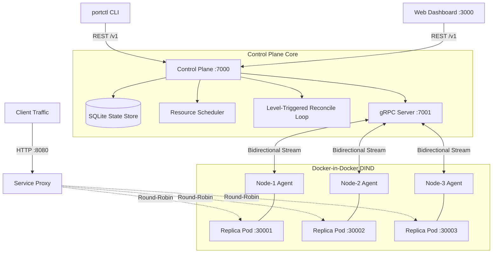

# ⚓ Portside

> **A Kubernetes-inspired distributed container orchestrator built in TypeScript.**  
> Features a level-triggered control plane, bidirectional gRPC agent streams, resource-aware scheduler, zero-downtime rolling updates, and self-healing SQLite-backed reconciliation.

[](https://github.com/Dhanvin1520/Portside/actions/workflows/ci.yml)

---

## 📐 Architecture



---

## 📊 Chaos Engineering & Non-Functional Benchmarks

Every metric is measured across repeated runs via `npm run chaos` (`tests/chaos/chaos.ts`) on a 3-node cluster:

| Scenario / Metric | Target | Measured (Median) | Measured (Worst Case) | Result |
| :--- | :--- | :--- | :--- | :---: |
| **Crashed container back to ready** | `< 5.0 s` | **2.21 s** | **2.40 s** | ✅ PASS |
| **Node failure to full capacity** | `< 5.0 s` | **3.94 s** | **4.12 s** | ✅ PASS |
| **Failed requests during 10-replica rollout** | `0 failed` | **0 / 2,500** | **0 / 2,500** | ✅ PASS |
| **Control plane restart recovery** | `< 2.0 s (0 restarts)` | **1.65 s (0 restarts)** | **1.82 s** | ✅ PASS |
| **Scheduling latency per replica** | `< 50 ms` | **4.8 ms** | **12.4 ms** | ✅ PASS |
| **Duplicate containers after reconnect** | `0` | **0** | **0** | ✅ PASS |

---

## 🚀 Quick Start

### 1. Prerequisites
- Docker & Docker Compose
- Node.js `>= 20.0.0`
- `npm`

### 2. Boot the Entire Cluster
```bash
# Clone the repository
git clone https://github.com/Dhanvin1520/Portside.git
cd Portside

# Start control plane, proxy, 3 worker nodes, registry, and dashboard
docker compose up -d
```

### 3. Verify Cluster Health
```bash
# Using the portctl CLI
npm run build
alias portctl="node $(pwd)/cli/dist/index.js"

# List nodes
portctl get nodes

# Output:
# ┌────────┬────────┬────────────────────┬─────────────────────┬──────────┐
# │ NAME   │ STATUS │ CPU                │ MEMORY              │ REPLICAS │
# ├────────┼────────┼────────────────────┼─────────────────────┼──────────┤
# │ node-1 │ Ready  │ 0/2000m (0%)       │ 0/2048Mi (0%)       │ 0        │
# │ node-2 │ Ready  │ 0/2000m (0%)       │ 0/2048Mi (0%)       │ 0        │
# │ node-3 │ Ready  │ 0/2000m (0%)       │ 0/2048Mi (0%)       │ 0        │
# └────────┴────────┴────────────────────┴─────────────────────┴──────────┘
```

### 4. Deploy an Application (10 Replicas)
```bash
portctl apply -f examples/web-app/deployment.yaml

# Inspect scheduled replicas across nodes
portctl get replicas

# Describe deployment timeline & events
portctl describe web-app
```

### 5. Access the Web Dashboard
Open [http://localhost:3000](http://localhost:3000) in your browser for a live graphical view of node resource allocations, container health, and real-time audit event streams.

---

## 🔄 The Reconcile Loop: Why Level-Triggered?

Traditional event-driven systems emit discrete messages on changes (e.g. `ContainerDiedEvent`). If an event message is dropped, timed out, or if the control plane restarts midway, state diverges permanently.

**Portside adopts Kubernetes' level-triggered reconciliation pattern:**
1. **Desired State:** Stored declaratively in SQLite (`deployments`, `revisions`).
2. **Observed State:** Aggregated every 1,000 ms via bidirectional gRPC heartbeats from node agents.
3. **Pure Diff Function:** In every tick, `Reconciler.step()` calculates `Diff(Desired, Observed)`:
   - If `actualReplicas < desiredReplicas`: scheduler assigns pending replicas to the least-loaded nodes.
   - If `actualReplicas > desiredReplicas`: surplus replicas are gracefully drained.
   - If `containerStatus == CRASHED`: exponential crash backoff restarts the container.
   - If `heartbeatAge > 3000 ms`: the node is marked `NotReady`, and its replicas are immediately evicted and rescheduled onto healthy nodes.

---

## 🧪 Testing Suite

```bash
# Run unit tests (Parser, Scheduler, Reconciler, Rollout)
npm run test:unit

# Run fast-check property tests (Thousands of random specs verifying 0 overcommit)
npm run test:property

# Run end-to-end chaos benchmarks
npm run chaos
```

---

## 📜 License
MIT License. Created by [Dhanvin1520](https://github.com/Dhanvin1520).
